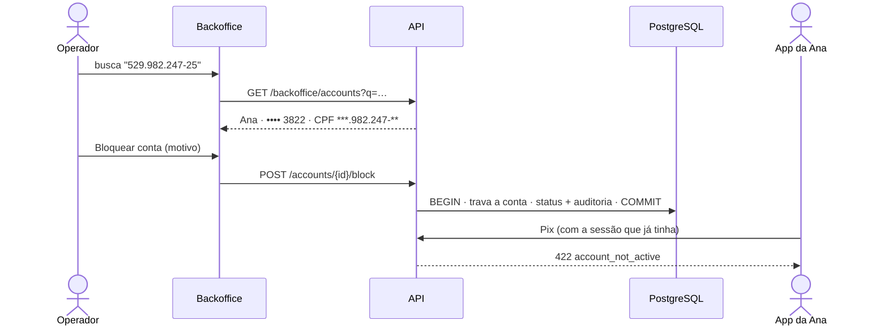
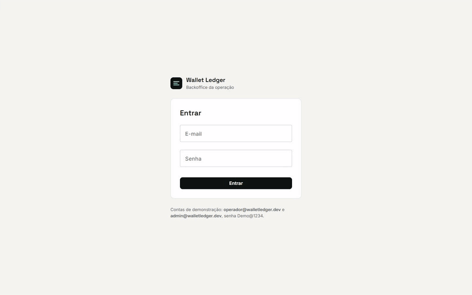

# Wallet Ledger Backoffice

[](https://github.com/Mavoxweb/wallet-ledger-backoffice/actions/workflows/ci.yml)


O painel da equipe de operação de uma carteira digital: achar a conta de um cliente, ver o extrato, bloquear uma conta suspeita, estornar um Pix enviado por engano e saber depois quem fez o quê, quando e por quê.

> **Faz parte do Wallet Ledger**
> - [wallet-ledger-api](https://github.com/Mavoxweb/wallet-ledger-api): API .NET com razão de partidas dobradas, idempotência e auditoria
> - [wallet-ledger-mobile](https://github.com/Mavoxweb/wallet-ledger-mobile): app do correntista em Flutter (Pix, extrato, QR code)
> - **wallet-ledger-backoffice**: este painel, em Angular

<p align="center">
  
</p>

---

## A ligação que este painel foi feito para atender

Sexta, 18h. A Ana liga: mandou R$ 50 para o Bruno por engano, e agora acha que alguém está usando o celular dela.

Do outro lado, a pessoa da operação precisa de três coisas, rápido e sem errar:

1. **Achar a conta da Ana** com o que ela disser ao telefone, seja o CPF com pontos, o e-mail ou o final da conta que aparece no app.
2. **Bloquear a conta já**, inclusive no app que está aberto no celular dela, sem esperar o token expirar.
3. **Devolver os R$ 50** do jeito certo: sem apagar nada do histórico, sem estornar duas vezes se a internet cair no meio, e só se o Bruno ainda tiver o dinheiro.

E, semanas depois, alguém da auditoria vai perguntar: **quem bloqueou essa conta, e por quê?**



## O que o painel faz

<p align="center">
  
</p>

- **Busca com um campo só.** CPF com ou sem pontuação, e-mail em maiúsculas, final da conta ou parte do nome: a API descobre o que foi digitado. A busca espera você parar de digitar (300 ms) e cancela a anterior, então uma resposta lenta nunca sobrescreve a mais nova.
- **Detalhe da conta** com o CPF **mascarado** (`***.982.247-**`): a operação não precisa ver o número inteiro. Extrato paginado, chaves Pix e a trilha da conta em abas. A aba fica na URL, então o link pode ser mandado para um colega.
- **Bloquear e desbloquear com motivo.** O diálogo diz a consequência ("…não vai conseguir enviar nem receber Pix, inclusive no app que já está aberto") e só libera o botão com um motivo de verdade, de 10 a 500 caracteres.
- **Estorno só para o admin**, só nas transações que ainda podem ser estornadas. O diálogo mostra **quem devolve para quem** e avisa que não dá para desfazer.
- **Auditoria** em todas as ações: quem fez, com qual perfil, quando, por quê e o que mudou ("Ativa → Bloqueada", "R$ 50,00 estornados"), com filtro por tipo de ação e por conta. Na trilha geral, a conta aparece com o **nome do titular** e o final (`Ana Beatriz Lima`, `•••• 3822`). O link leva direto à conta.

<p align="center">
  
</p>

## Por dentro: as decisões que importam

| | Como foi resolvido | Decisão |
|---|---|---|
| **Estorno duplicado** | A `Idempotency-Key` nasce quando o admin confirma e é **reusada** na nova tentativa depois de um erro de rede. Se o primeiro pedido chegou, a API devolve a mesma resposta em vez de estornar de novo | [ADR 0005 da API](https://github.com/Mavoxweb/wallet-ledger-api/blob/main/docs/adr/0005-idempotencia-no-postgres.md) |
| **Sessão em conexão ruim** | Um `401` renova o token **uma vez só**, mesmo com vários pedidos ao mesmo tempo (a API gira o refresh token). Erro de rede ou `5xx` na renovação mantém a sessão; só uma recusa da API leva ao login | [`auth.interceptor.ts`](src/app/core/auth/auth.interceptor.ts) |
| **Quem pode o quê** | A regra está na API (`403` para perfil errado). A tela só esconde: guards por perfil e "Estornar" visível só para o admin | [ADR 0003](docs/adr/0003-autorizacao-no-servidor.md) |
| **Contrato com a API** | Cliente TypeScript **gerado** do `openapi.json` do commit `e57a62f` no main da API. A release `v0.2.1` ainda não existe; o CI regenera e falha se divergir | [ADR 0002](docs/adr/0002-cliente-gerado.md) |
| **Estado da tela** | Signals e componentes standalone; RxJS só onde o tempo importa (espera da busca, cancelamento, renovação do token) | [ADR 0001](docs/adr/0001-signals-e-standalone.md) |

Do lado da API, a auditoria é gravada **na mesma transação** da ação, e dois estornos simultâneos da mesma transação viram um sucesso e um `409` ([ADR 0007 da API](https://github.com/Mavoxweb/wallet-ledger-api/blob/main/docs/adr/0007-auditoria-na-mesma-transacao.md)).

## Como rodar

Pré-requisitos: **Node 24.15+** (ou 26) e **Docker**.

```bash
# 1. A API, com PostgreSQL e contas de demonstração
git clone https://github.com/Mavoxweb/wallet-ledger-api.git
cd wallet-ledger-api && docker compose up --build -d && cd ..

# 2. O painel
git clone https://github.com/Mavoxweb/wallet-ledger-backoffice.git
cd wallet-ledger-backoffice
npm install
npm start
```

Abra http://localhost:4200. As contas de demonstração usam a senha `Demo@1234`:

| E-mail | Perfil | O que pode |
|---|---|---|
| `operador@walletledger.dev` | Operador | Buscar, ver extrato, bloquear e desbloquear |
| `admin@walletledger.dev` | Admin | Tudo do operador, mais estornar |
| `ana@walletledger.dev` | Cliente | Nada aqui: o login é recusado (use o [app](https://github.com/Mavoxweb/wallet-ledger-mobile)) |

Em desenvolvimento, o `ng serve` repassa `/api` para `localhost:8080` (`proxy.conf.json`): o navegador fala com uma origem só, e a API não precisa liberar CORS para o painel.

## Testes

```bash
npm test          # 87 testes unitários e de componente (Vitest)
npm run e2e       # 3 testes ponta a ponta (Playwright), com a API rodando em localhost:8080
```

Os principais:

- **Ponta a ponta, contra a API de verdade:**
  - o operador bloqueia a Ana pela tela e, **com a sessão que o app dela já tinha**, o Pix é recusado com `account_not_active`;
  - a auditoria registra o bloqueio e mostra o nome da titular;
  - o admin estorna um Pix, que fica "Estornada", enquanto o estorno aparece no extrato.
- **Três `401` simultâneos fazem uma renovação só**, e uma queda de rede na renovação não desloga ninguém.
- **A nova tentativa do estorno usa a mesma `Idempotency-Key`**, e mudar o motivo gera uma chave nova.
- **Três teclas rápidas viram uma busca só**, com relógio controlado no teste.

No CI, o job ponta a ponta baixa o repositório da API **na versão de `contract.version`**, sobe API e PostgreSQL com Docker Compose e roda o Playwright no Chromium.

## Limites honestos

- **Ainda não há demo online.** O painel roda local, apontando para a API em Docker. Para publicar, falta um proxy (ou CORS na API) e um ambiente para a API.
- **O dinheiro é fictício.** O Pix acontece entre contas deste sistema, sem integração com o Banco Central.
- **Sem gestão de usuários da equipe.** Operador e admin vêm do seed de demonstração.

---

## Sobre este projeto

Na [API](https://github.com/Mavoxweb/wallet-ledger-api) eu garanti que o dinheiro não some nem duplica, e no [app](https://github.com/Mavoxweb/wallet-ledger-mobile) levei essa garantia até o dedo do cliente. Faltava o lado de quem atende o telefone quando algo dá errado. É ali que uma carteira digital mostra se é confiável: no bloqueio que vale na hora, no estorno que não acontece duas vezes, no registro que responde "quem fez isso?".

Também foi meu projeto para usar o Angular moderno de verdade (signals, standalone, interceptor funcional) numa ferramenta com regras de negócio sérias, não numa lista de tarefas. As decisões que não são óbvias estão nos ADRs e comentadas no código.

Se você trabalha com operação ou back-office financeiro e faria alguma coisa diferente, me conta. Vou gostar da conversa.

**Alex Marques** · Desenvolvedor Full Stack · Rio de Janeiro
[LinkedIn](https://www.linkedin.com/in/alex-marques-455089205) · [GitHub](https://github.com/Mavoxweb)
